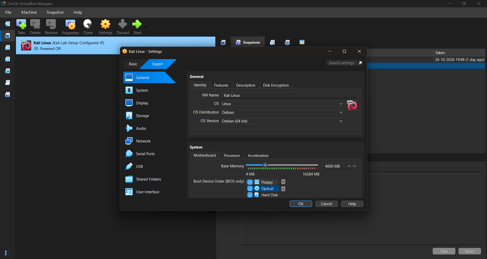
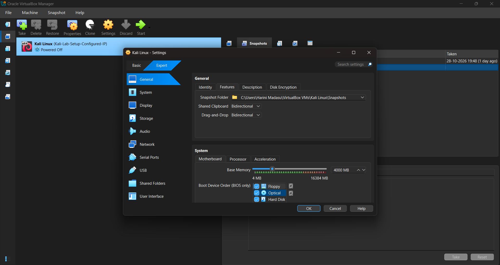
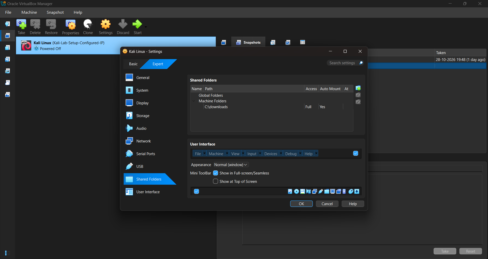
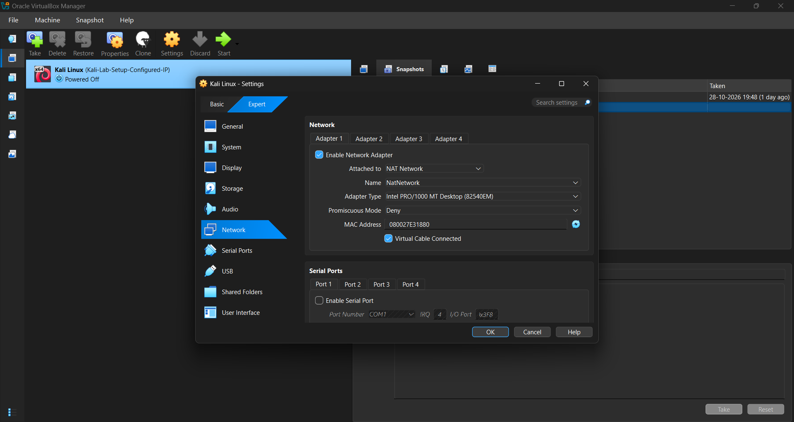
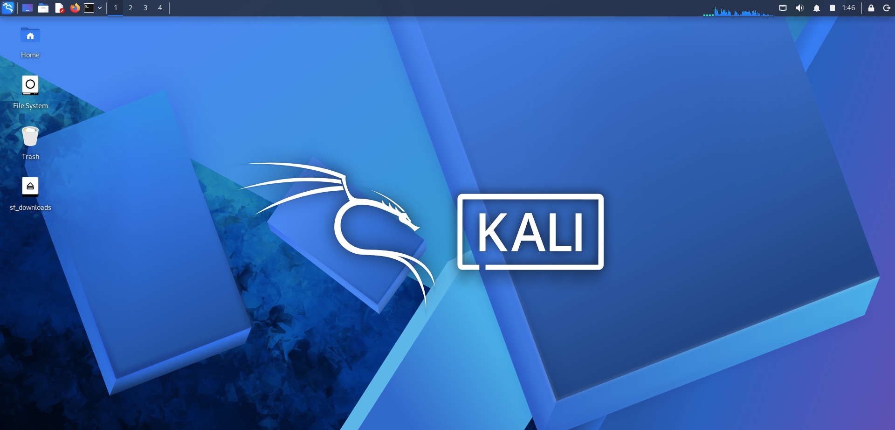
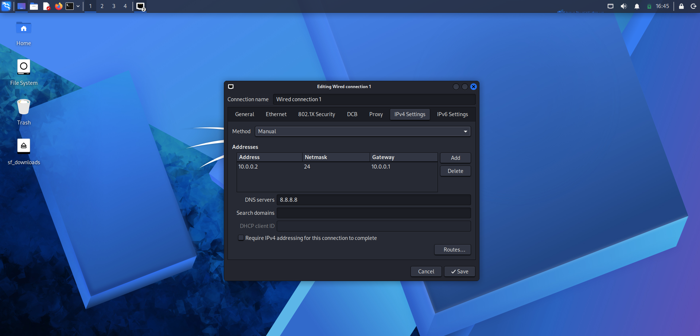
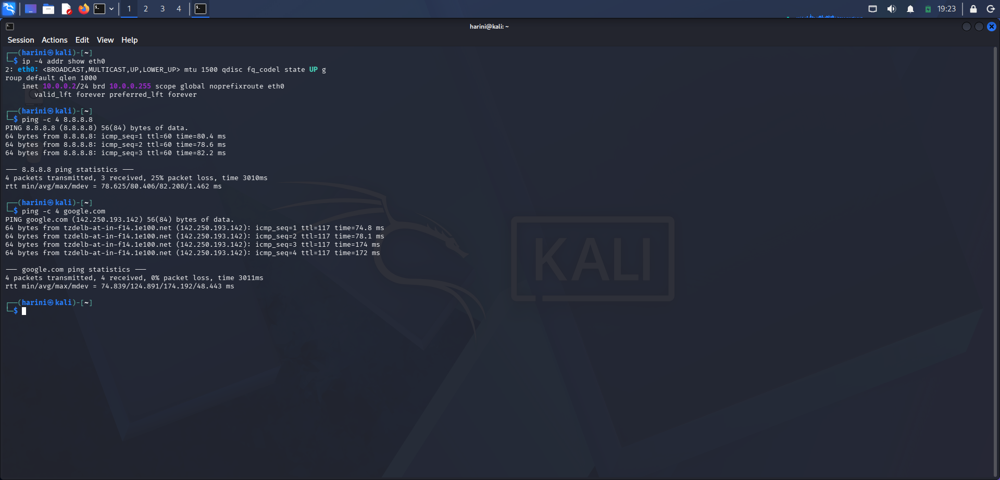
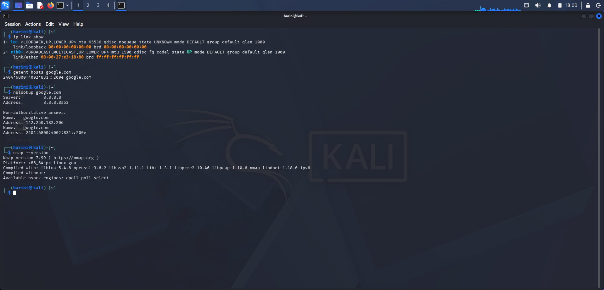
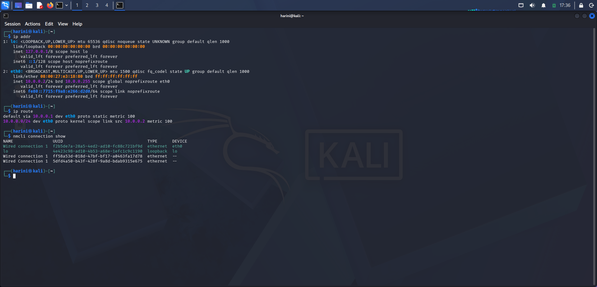
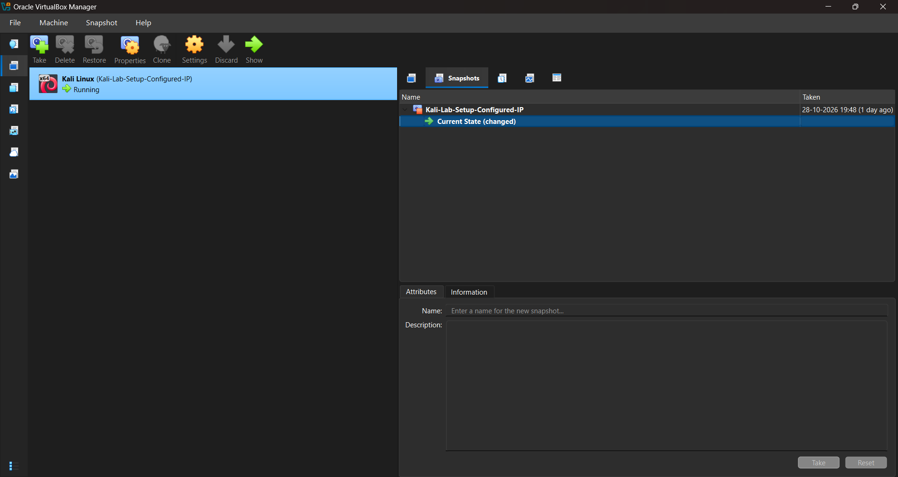

# 🛡️ Cybersecurity Lab Setup Using VirtualBox and Kali Linux

## 1. Project Overview

This project focuses on building a virtual cybersecurity lab using Oracle VirtualBox and Kali Linux. The environment provides a practical platform for learning Linux administration, virtual networking, connectivity troubleshooting, and cybersecurity tools.

The lab includes a configured NAT Network, shared folder, bidirectional clipboard and drag-and-drop features, and a virtual machine snapshot. Network configuration, internet connectivity, DNS resolution, and Nmap availability were checked using Linux commands.

---

## 2. Project Objectives

- Install and configure Oracle VirtualBox and Kali Linux.
- Configure virtual machine resources and networking.
- Establish connectivity through a VirtualBox NAT Network.
- Verify IP addresses, network interfaces, routing, and DNS resolution.
- Test internet connectivity using Linux networking commands.
- Verify Nmap availability.
- Configure shared folders and bidirectional integration features.
- Create a virtual machine snapshot for recovery.
- Document configuration, troubleshooting, and verification results.

---

## 3. Purpose of the Project

The objective was to build a practical Linux-based cybersecurity environment using virtualization.

This lab establishes the foundation for hands-on network analysis, security tool usage, and authorized security testing without requiring a separate physical computer.

---

## 4. Lab Architecture

| Component | Configuration |
|---|---|
| Host Operating System | Windows |
| Virtualization Platform | Oracle VirtualBox |
| Guest Operating System | Kali Linux |
| Network Mode | NAT Network |
| Network Range | `10.0.0.0/24` |
| Shared Folder | `sf_downloads` |
| Recovery Mechanism | Virtual machine snapshot |

### Architecture Flow

```text
Windows Host
     |
     v
Oracle VirtualBox
     |
     v
Kali Linux Virtual Machine
     |
     v
VirtualBox NAT Network
     |
     v
External Network / Internet
```

The NAT Network provides network connectivity for the virtual machine, while the shared folder facilitates file transfer between the host and guest operating systems.

---

## 5. Lab Setup Procedure

### Step 1: Download the Required Software

Downloaded the required software to set up the virtual cybersecurity lab.

- **Oracle VirtualBox:** [Official Website](https://www.virtualbox.org/)
- **Kali Linux:** [Official Website](https://www.kali.org/)

Oracle VirtualBox provides the virtualization platform, while Kali Linux serves as the guest operating system for cybersecurity practice.

---

### Step 2: Configure the Virtual Machine

The Kali Linux virtual machine was configured in VirtualBox with appropriate system resources based on the host computer's available hardware.

Virtualization allows Kali Linux to operate as a guest operating system without replacing Windows.



---

### Step 3: Configure Bidirectional Features

The Shared Clipboard and Drag'n'Drop settings were configured for bidirectional operation between Windows and Kali Linux.

These features improve interaction between the host and guest operating systems.

**Screenshot:**



---

### Step 4: Configure the Shared Folder

A VirtualBox shared folder named `sf_downloads` was configured to facilitate file transfers between Windows and Kali Linux.

**Screenshot:**



---

### Step 5: Configure the NAT Network

A VirtualBox NAT Network was configured with the network range `10.0.0.0/24`.

This configuration allows connected virtual machines to communicate through the NAT Network and access external networks when the network is functioning correctly.

**Screenshot:**



---

### Step 6: Start Kali Linux

The virtual machine was started to verify that Kali Linux booted successfully and its desktop environment was accessible.

---

### Step 7: Verify the Kali Linux Desktop

The Kali Linux desktop was inspected to confirm that the guest operating system was accessible and ready for use.

**Screenshot:**



---

### Step 8: Inspect Network Configuration

The following command was used to inspect the IPv4 configuration of the `eth0` interface:

```bash
ip -4 addr show eth0
```

This helps identify the interface's assigned IPv4 address and subnet configuration.

**Screenshot:**




---

### Step 9: Test Internet Connectivity

Connectivity was tested using an external IP address and a domain name.

```bash
ping -c 4 8.8.8.8
ping -c 4 google.com
```

- The first command tests reachability to an external IP address.
- The second tests connectivity using a domain name and also exercises DNS resolution.

The results were examined to determine whether the destinations responded.

**Screenshot:**



---

### Step 10: Verify DNS Resolution and Nmap

DNS resolution was checked using:

```bash
getent hosts google.com
```

This command checks name resolution through the system's configured resolver mechanisms.

Nmap availability was checked using:

```bash
nmap --version
```

This displays Nmap's version information and confirms that the command is available.

Additional network inspection commands included:

```bash
ip addr show
ip route
ip link show
```

These display interface addresses, routing information, and network interface status.

**Screenshot:**



---

### Step 11: Review Network Connectivity

The network configuration and connectivity test results were reviewed to assess whether Kali Linux could communicate as expected.

**Screenshot:**



---

### Step 12: Create a Virtual Machine Snapshot

A VirtualBox snapshot was created to preserve the virtual machine's state at a known point in the setup process.

This provides a recovery point if subsequent configuration changes cause problems. A snapshot does not replace a separate backup of important files.




---

## 6. Network Verification Summary

| Command | Purpose |
|---|---|
| `ip -4 addr show eth0` | Inspects the IPv4 address of the specified interface |
| `ip addr show` | Displays network interfaces and assigned addresses |
| `ip route` | Displays the routing table and default route, if configured |
| `ip link show` | Shows network interface status |
| `ping -c 4 8.8.8.8` | Tests reachability to an external IP address |
| `ping -c 4 google.com` | Tests reachability using a domain name |
| `getent hosts google.com` | Checks system name resolution |
| `nmap --version` | Checks Nmap availability and version |

The commands provide evidence of network configuration and testing. Actual success should be determined from the captured output.

---

## 7. Problems Encountered and Troubleshooting

### Problem 1: Kali Linux ISO Download Interruption

**Issue:** The Kali Linux ISO download repeatedly stopped near the end, around 4.47–4.48 GB. Chrome displayed an incomplete `.crdownload` file.

**Solution:**

1. Opened Chrome's Downloads page to inspect the download status.
2. Checked the incomplete download and addressed the interrupted download.
3. Retried the download as needed and proceeded once the ISO was available.

---

### Problem 2: IP Address Conflict During Network Configuration

**Issue:** While configuring the Kali Linux network, an IP address conflict error appeared, indicating that the same IP address was already in use. The error also displayed a connection UUID.

**Solution:**

**Step 1: List the existing NetworkManager connections.**

```bash
nmcli connection show
```

**Step 2: Configure the existing `Wired connection 1` profile with the required static IP settings.**

```bash
sudo nmcli connection modify "Wired connection 1" ipv4.method manual ipv4.addresses 10.0.0.2/24 ipv4.gateway 10.0.0.1 ipv4.dns 10.0.0.1
```

**Step 3: Adjust the duplicate address detection timeout setting.**

```bash
sudo nmcli connection modify "Wired connection 1" ipv4.dad-timeout 0
```

**Step 4: Activate the updated connection profile.**

```bash
sudo nmcli connection up "Wired connection 1"
```

This approach modified the existing connection profile instead of creating another one. The address configuration and connectivity were then checked.

---

### Problem 3: Ethernet Connectivity Issue

**Issue:** Kali Linux experienced an Ethernet connectivity issue while setting up the network.

**Step 1: Check the network device status.**

```bash
nmcli device status
```

This command displays network devices and their current connection states.

**Step 2: Attempt to connect the Ethernet interface.**

```bash
sudo nmcli device connect eth0
```

This command asks NetworkManager to connect the `eth0` interface using an appropriate connection profile.

**Verification:** After addressing the issue, check the interface status and test connectivity using the network verification commands documented in Section 6.

---

## 8. Key Learnings

- **Virtualization:** Learned to configure a Kali Linux virtual machine, manage system resources, configure shared folders, and create snapshots.
- **Networking:** Understood IPv4 addressing, CIDR notation, NAT Network configuration, network interfaces, and routing.
- **Connectivity and DNS:** Practiced testing connectivity using `ping` and checking domain name resolution using `getent hosts`.
- **Troubleshooting:** Gained experience investigating IP address conflicts and Ethernet connectivity issues using Linux commands.
- **Cybersecurity Tools:** Verified Nmap availability and understood its role in network discovery and authorized security auditing.
- **Documentation:** Learned to document configurations, troubleshooting steps, and results using screenshots and GitHub.

---

## 9. Why This Lab Is Useful for Cybersecurity

This lab builds practical skills in Linux, networking, DNS, connectivity troubleshooting, and security tool verification. These fundamentals are directly useful when preparing for hands-on SOC, network security, and penetration-testing labs.

---

## 11. Tools and Resources

- [Oracle VirtualBox](https://www.virtualbox.org/) — Virtualization platform.
- [Kali Linux](https://www.kali.org/) — Operating system for cybersecurity practice.
- [Nmap](https://nmap.org/) — Network discovery and security auditing.
- [7-Zip](https://www.7-zip.org/) — Archive extraction utility, if used.
- [GitHub](https://github.com/) — Repository hosting and project documentation.

---

## 12. Author

**Harini Madasu**  
B.Tech Mathematics and Computing Student

[My LinkedIn Profile](https://www.linkedin.com/in/harini-madasu-91258b357)


