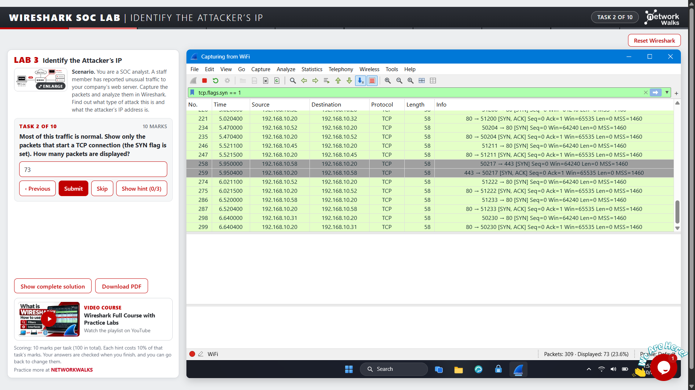
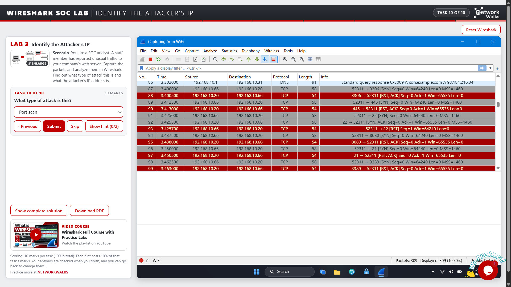
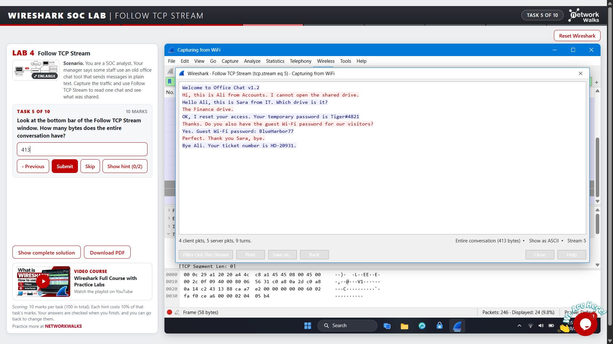
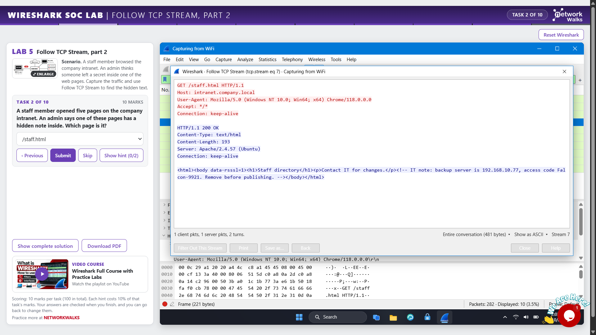
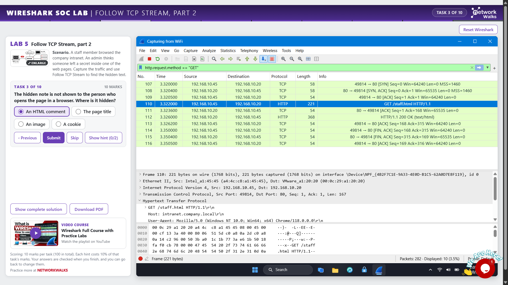
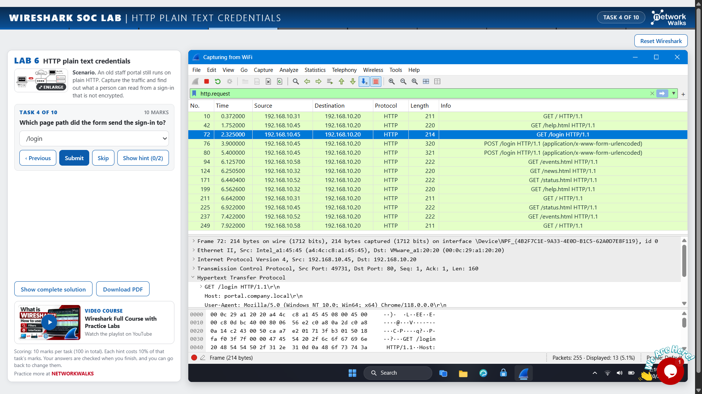
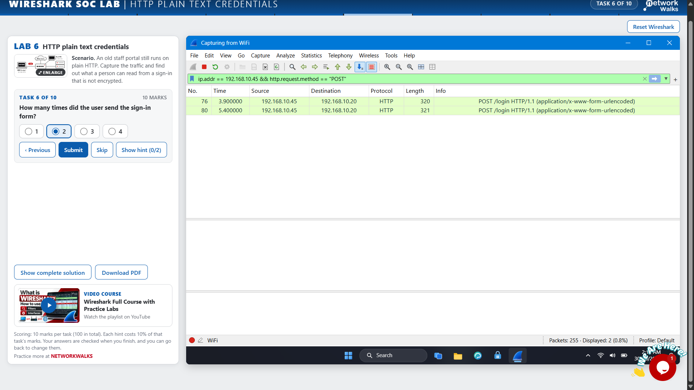
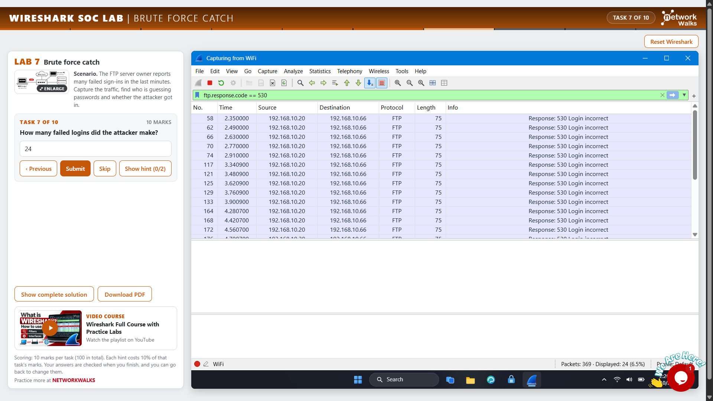
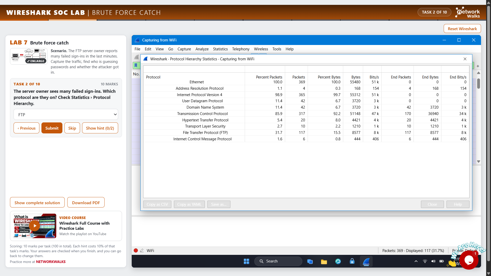
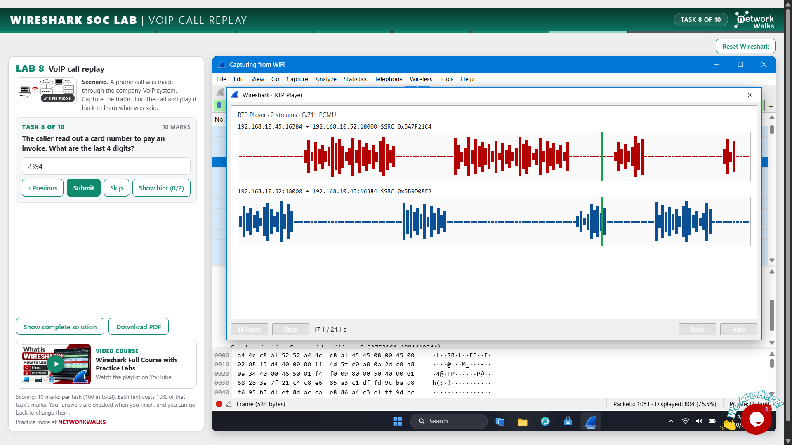

# 🦈 Wireshark – Network Traffic Analysis

## 1. Project Overview

This project focuses on practical network traffic analysis using **Wireshark**. Across six hands-on labs, I explored packet inspection, TCP stream reconstruction, HTTP plaintext credential exposure, potential brute-force activity, and SIP/RTP traffic analysis.

The project demonstrates how captured network traffic can be examined to investigate suspicious activity and understand network security risks.

---

## 2. Project Objectives

- Analyze captured network packets using Wireshark.
- Identify a suspected attacker's IP address.
- Reconstruct network conversations using **Follow TCP Stream**.
- Examine HTTP traffic and plaintext credential exposure.
- Investigate repeated login attempts for potential brute-force activity.
- Analyze SIP/RTP traffic associated with communication sessions.
- Use display filters to isolate relevant packets.

---

## 3. Tools and Technologies

| Tool / Technology | Purpose |
|---|---|
| **Wireshark** | Network packet inspection and analysis |
| **Display Filters** | Isolate relevant packets |
| **TCP Stream Analysis** | Reconstruct and inspect TCP conversations |
| **HTTP Analysis** | Examine web traffic and potential plaintext data exposure |
| **SIP/RTP Analysis** | Investigate signaling and real-time communication traffic |

---

## 4. Labs and Practical Analysis

### Lab 1: Identify the Attacker's IP

**Objective:** Investigate captured network traffic to identify a suspected attacker's IP address.

**Concepts Covered:**
- Source and destination IP addresses.
- Packet inspection and traffic analysis.
- Identifying potentially suspicious network activity.

**Key Learning:** Understood how packet information and IP addresses can help investigate suspicious network communications.

---

### Lab 2: Follow TCP Stream – Part 1

**Objective:** Reconstruct and inspect a TCP conversation using Wireshark.

**Concepts Covered:**
- TCP communication between endpoints.
- **Follow TCP Stream**.
- Inspection of data exchanged within a TCP conversation.

**Key Learning:** Learned how stream reconstruction makes it easier to investigate conversations than examining individual packets separately.

---

### Lab 3: Follow TCP Stream – Part 2

**Objective:** Continue investigating network conversations through TCP stream analysis.

**Concepts Covered:**
- Reconstructed TCP conversations.
- Inspection of exchanged data.
- Relationship between packets and a TCP stream.

**Key Learning:** Improved my understanding of TCP stream reconstruction and network communication analysis.

---

### Lab 4: HTTP Plaintext Credentials

**Objective:** Examine HTTP traffic and understand the risks of transmitting sensitive information without encryption.

**Concepts Covered:**
- HTTP packet inspection.
- Examination of readable application data.
- Potential exposure of plaintext credentials.
- Importance of HTTPS for protecting data in transit.

**Key Learning:** Understood how unencrypted HTTP communication can expose sensitive information to someone able to capture and inspect the traffic.

---

### Lab 5: Catch the Brute Force Attacker

**Objective:** Investigate captured network traffic for patterns associated with repeated authentication attempts and potential brute-force activity.

**Concepts Covered:**
- **Repeated Login Attempts:** Examining authentication-related traffic for repeated attempts.
- **Source IP Identification:** Investigating the origin of suspicious requests.
- **Packet Inspection:** Examining relevant packets and request patterns.
- **Authentication Traffic:** Inspecting authentication-related data when visible in the capture.
- **Display Filters:** Isolating relevant traffic for investigation.
- **Attack Indicators:** Recognizing patterns that may warrant further investigation.

**Key Learning:** Learned how packet analysis can help identify patterns associated with brute-force attempts. Repeated attempts alone do not conclusively establish an attack; the surrounding traffic and context must also be considered.

---

### Lab 6: Catch the Call Scammer

**Objective:** Investigate communication traffic and understand how SIP/RTP analysis can support suspicious-call investigations.

**Concepts Covered:**
- **SIP (Session Initiation Protocol):** Signaling used to establish, manage, and terminate communication sessions.
- **RTP (Real-time Transport Protocol):** Transport of real-time audio and video data.
- **Packet Inspection:** Examining relevant communication packets.
- **Display Filters:** Isolating relevant SIP/RTP traffic.
- **Traffic Investigation:** Examining communication patterns for investigation.

**Key Learning:** Gained introductory experience examining SIP/RTP traffic and understanding how protocol analysis can support communication investigations.

---

## 5. Key Learnings

- **Packet Analysis:** Inspected packets and examined source and destination addresses.
- **TCP Stream Analysis:** Practiced reconstructing and inspecting TCP conversations.
- **HTTP Security:** Understood the risks of transmitting sensitive data without encryption.
- **Attack Investigation:** Explored traffic patterns associated with potential brute-force activity.
- **Protocol Analysis:** Gained introductory experience with SIP/RTP traffic.
- **Display Filters:** Learned to isolate relevant packets during network investigations.
- **Cybersecurity Investigation:** Improved my understanding of how packet analysis supports network security monitoring.

---

## 6. Relevance to Cybersecurity and SOC Operations

Network traffic analysis is useful in Security Operations Center (SOC) environments for investigating suspicious communications, examining potential credential exposure, investigating unusual authentication activity, and supporting incident response.

These hands-on labs provided introductory experience with network investigation techniques relevant to cybersecurity monitoring and analysis.

---

## 7. Conclusion

The six Wireshark labs provided practical exposure to packet inspection, TCP stream reconstruction, HTTP security risks, potential brute-force activity, and SIP/RTP traffic analysis.

This project strengthened my understanding of network protocols and how captured network traffic can be investigated to support cybersecurity analysis.

---

## 8. Author

**Harini Madasu**  
B.Tech Mathematics and Computing

[LinkedIn Profile](https://www.linkedin.com/in/harini-madasu-91258b357)

---

